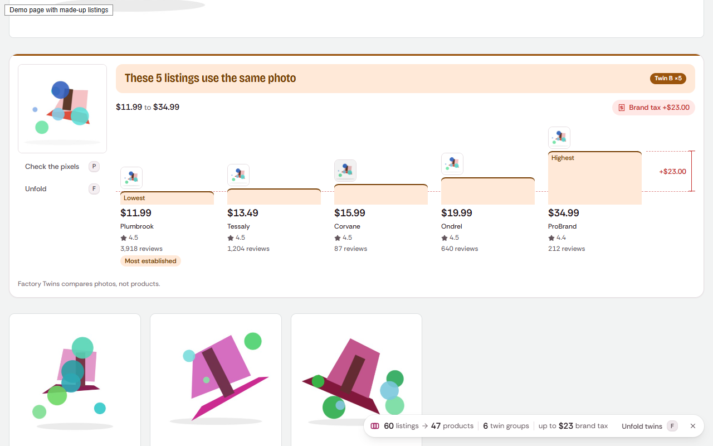

# Factory Twins

**A browser extension that shows which listings on an Amazon or Walmart search page use the same factory photo, and what the name on the box costs you.**

[](https://github.com/NINJA981/factory-twins/actions/workflows/ci.yml)
[](LICENSE)



<sub>Screenshot of the real extension on a made-up demo store. Every brand, price and rating in it is invented.</sub>

Search for "laptop stand" and page 1 often holds the same product photo under five brand names. Factory
Twins rings every listing that shares a photo, folds each group into one card with a price ladder, and
tags the spread as **brand tax**. A Proof lens lays the two photos over each other so you can check the
match by eye. It runs on your device: no account, no server, no tracking.

It compares **photos, not products**. A group can mix an original with a listing that borrowed its
picture, so the extension shows the evidence (photos, prices, ratings, review counts) and leaves the
verdict to you.

## Status

Version 0.1.0. The extension, its interface and the test suite are complete, but it has **only been
tested on synthetic store pages**, not on live amazon.com or walmart.com. It is not in the Chrome Web Store
or on addons.mozilla.org yet. Read [Limitations](#limitations) before you rely on it.

## Install

Not in the stores yet, so you load a build yourself.

### Chrome, Edge, Brave and other Chromium browsers (desktop)

1. Download `factory-twins-0.1.0-chrome.zip` from the latest release and unzip it, or build it from
   source (see [Development](#development)); the build is in `.output/chrome-mv3`.
2. Open `chrome://extensions` and switch on **Developer mode**.
3. Choose **Load unpacked** and pick the unzipped folder (the one that contains `manifest.json`).
4. Search on amazon.com or walmart.com. The summary pill appears in the corner of the results.

### Firefox 140 or newer (untested)

The Firefox build passes Mozilla's `web-ext lint`, but nobody has run it in Firefox yet.

1. Download `factory-twins-0.1.0-firefox.zip` from the latest release, or build it with
   `pnpm build:firefox` (output in `.output/firefox-mv3`).
2. Open `about:debugging#/runtime/this-firefox` and choose **Load Temporary Add-on**.
3. Pick the zip file, or `manifest.json` inside the build folder.

Firefox removes temporary add-ons when it restarts.

## Use it

| Key | What it does |
|---|---|
| `T` (or `Alt+Shift+T`) | Ring every twin group in its own colour, letter and pattern |
| `F` (or `Alt+Shift+F`) | Fold each group into one card with a price ladder; again to unfold |
| `P` | Open the Proof lens on the focused group: onion skin and Difference views, with the share of pixels that match |
| `?` | Show all shortcuts |

Single-letter keys can be switched off in Options; the `Alt+Shift` commands and the pill buttons always
work. Keys never fire while you type in a text field. In the Proof lens, `O` and `D` switch views and the
arrow keys move the slider.

## How it works

1. A content script reads the result tiles on the two search pages (one isolated adapter per store in
   `src/adapters`).
2. The background re-reads each thumbnail from the store's own image server, in an offscreen document on
   Chrome or the background page on Firefox, and turns it into three perceptual hashes: a 64-bit dHash, a
   64-bit DCT pHash and a coarse colour signature. Blank or flat placeholder photos are flagged and never
   matched.
3. Two listings are twins when all three hashes are close (pHash within 6 bits, dHash within 10, colour
   within 0.06) and their titles agree on what the thing is. Groups are split around their medoid so a
   chain of near-matches cannot grow without bound, and colour or size variants of one listing are
   labelled as variants, not twins.
4. Brand tax is the highest minus the lowest comparable price in a group. Prices are compared per unit when
   pack sizes differ; listings with an uncertain pack size or a price range ("from $12.99") stay on the
   ladder but are left out of the brand tax.
5. The Proof lens resamples both photos to 256 × 256 and counts the pixels that differ, leaving out white
   background that both photos share. It never rounds up to 100%.

The engine in `src/core` is pure TypeScript with no extension APIs; a test fails if it ever imports one.
The same engine powers the [web app](site/) in `site/`, which runs the comparison on photos you pick.

## Privacy

Nothing leaves your device. There is no Factory Twins server, no account and no analytics.

- **Network:** the only requests are re-reads of the product thumbnails the search page already shows, from
  the store's own image servers (`m.media-amazon.com`, `images-na.ssl-images-amazon.com`,
  `i5.walmartimages.com`), sent without cookies and without a referrer. The popup counts every read by host,
  so you can check this yourself. A URL on any other host is never requested.
- **Stored:** your settings in `storage.local`; the photo hashes, the per-search memory (so page 2 joins
  page 1) and the read counter in `storage.session`, which the browser clears when it closes. Options has
  a switch to turn search memory off and a button to clear it.
- **Not stored:** photos (pixels are dropped right after hashing), your search history beyond the current
  browser session, or anything about you.

### Permissions, and why

| Permission | Why it is needed |
|---|---|
| Content scripts on `https://www.amazon.com/s*` and `https://www.walmart.com/search*` | Read the result tiles and draw the pill, rings and fold cards. Nowhere else. |
| Host access to the three image hosts above | Re-read thumbnails to hash them. A page's own images cannot be read pixel by pixel from the page itself. |
| `storage` | Settings, and the per-session memory described above. |
| `offscreen` (Chrome only) | Decode and hash images off the page's main thread. Firefox does this in its background page. |

A release build fails if any other permission, host or match pattern appears in its manifest
(`scripts/check-release-manifest.mjs`).

## Limitations

These are known and not hidden. Each one is tracked in [HANDOFF.md](HANDOFF.md).

- **Not tried on live store pages.** All tests run on synthetic pages built to look like Amazon and Walmart
  search results. The selectors in `src/adapters`, and the image hosts above, come from the public page
  structure and have not been checked against live amazon.com or walmart.com. **The Walmart adapter in
  particular is unverified**: its item-id attribute, image host and price markup are educated guesses.
- **Matching accuracy on real photos is unmeasured.** The thresholds were tuned on a synthetic photo
  corpus. On that corpus, 93.75% of re-uploaded copies (re-encoded, resized or cropped by a few percent)
  stay within the pHash threshold; the target is 98%, so some real twins will be missed. No false-match
  rate on real photos has been measured. Treat a ring as "worth a look", and use the Proof lens.
- **Firefox build untested** (see Install).
- **The pill does not move out of the way** of store widgets such as a sticky cart (SPEC AC-F4.3 is not
  built).
- **Client-side navigation:** a new search inside the same tab is picked up within about a second. A
  Walmart search reached from a non-search Walmart page without a reload is not picked up until you
  reload, because the content script only loads on search URLs.
- **Lazy tiles:** a tile whose photo is still a placeholder when it appears is skipped until the next
  rescan; a tile the store re-renders into a new element can lose its ring until the next search.
- **Cold start:** the very first popup open in a fresh browser took 190 to 290 ms in testing (warm opens 40
  to 60 ms), and the first pill after a cold start can take longer than 1.5 s on a busy machine.
- Desktop browsers only; extensions cannot run in the store apps on phones. Amazon.com and Walmart.com
  (US) search results only.

Factory Twins is not affiliated with Amazon or Walmart. Their names only say where the extension runs.

## Development

Needs Node 24 and pnpm 10.

```
pnpm install
pnpm build              # .output/chrome-mv3, then checks the release manifest
pnpm build:firefox      # .output/firefox-mv3
pnpm zip && pnpm zip:firefox   # release zips in .output/
pnpm lint               # eslint and prettier --check
pnpm typecheck
pnpm test               # unit tests (vitest)
pnpm test:e2e           # builds a test variant and drives the real extension in Chromium with Playwright
pnpm size               # bundle budgets, after pnpm build
```

To see it without visiting a store, run `pnpm build:e2e`, load `.output/chrome-mv3-e2e` unpacked, then
`node scripts/serve-fixtures.mjs` and open `http://localhost:4817/s?k=laptop+stand`: a made-up store with
60 listings and six twin groups.

| Path | What it is |
|---|---|
| `src/core` | Hashing, clustering, prices, text, state machines. Pure, shared with the web app. |
| `src/adapters` | One module per store: selectors, tile reading, query parsing |
| `src/hasher` | Allowlist, image fetch and decode, offscreen document lifecycle |
| `src/background`, `src/content`, `entrypoints` | Extension wiring (WXT) |
| `src/overlay`, `src/ui` | Pill, rings, fold card, Proof lens; popup and options (React, Tailwind) |
| `site/` | Landing page and web app (static Vite build) |
| `tests/` | Unit tests, Playwright tests and the synthetic fixture corpus |

Design decisions are in [docs/adr/0001-architecture.md](docs/adr/0001-architecture.md), the product spec in
[SPEC.md](SPEC.md), the visual system in [DESIGN.md](DESIGN.md), and which test covers which acceptance
criterion in [docs/TEST_MATRIX.md](docs/TEST_MATRIX.md).

## Contributing

Bug reports from real search pages are the most useful thing right now. See
[CONTRIBUTING.md](CONTRIBUTING.md), the [Code of Conduct](CODE_OF_CONDUCT.md), and
[SECURITY.md](SECURITY.md) for private reports.

## License

MIT. See [LICENSE](LICENSE).
